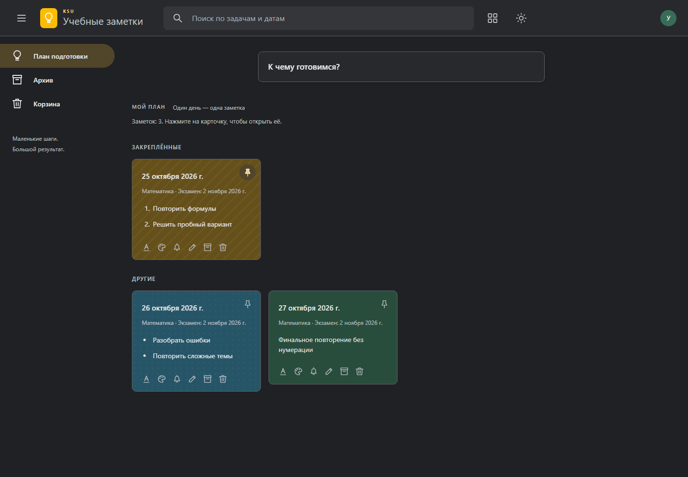

<div align="center">

# KSU Study Planner

### Учебные заметки и план подготовки к экзаменам

[](keep.html)
[](styles/app.css)
[](scripts/app.js)
[](#быстрый-старт)

Локальный планировщик, который превращает список тем в понятный план подготовки. Работает без сервера, регистрации и сторонних зависимостей.

[Возможности](#возможности) · [Быстрый старт](#быстрый-старт) · [Использование](#как-пользоваться) · [Архитектура](#структура) · [Ограничения](#ограничения)



</div>

## Возможности

| Область | Что поддерживается |
|---|---|
| Планирование | Выбор дней недели и равномерное распределение задач до даты экзамена |
| Текст | Обычный текст, нумерованные и маркированные списки с продолжением по Enter |
| Организация | Закрепление, поиск, архив, корзина и восстановление |
| Оформление | Цвета, фоновые узоры и форматирование текста |
| Напоминания | Завтра, следующая неделя или произвольные дата и время |
| Сохранение | Автосохранение данных и состояния интерфейса в браузере |
| Интерфейс | Светлая и тёмная темы, адаптивная сетка и компактное боковое меню |

Заметки в корзине автоматически удаляются через 7 дней. Корзину также можно очистить вручную.

## Быстрый старт

Проект не требует установки пакетов и сборки. Нужен современный браузер.

```powershell
git clone https://github.com/desk1qq/ksu-study-planner.git
cd ksu-study-planner
Start-Process .\keep.html
```

Или скачайте репозиторий и откройте [`keep.html`](keep.html) двойным щелчком.

Для разработки можно открыть папку в Visual Studio Code и запустить `keep.html` через Live Server. Сборка и установка пакетов не требуются.

## Как пользоваться

1. Нажмите на слова «К чему готовимся?», чтобы раскрыть форму.
2. Введите предмет, дату экзамена и текст заметки.
3. Самостоятельно отметьте дни недели, в которые готовы заниматься: изначально ни один день не выбран.
4. Для списка начните строку с `1.` или `-`.
5. Нажмите «Составить план» или щёлкните вне заполненной формы.
6. Откройте карточку, чтобы изменить предмет, дату экзамена, текст, оформление или напоминание.

Если щёлкнуть вне пустой формы, она свернётся без создания заметки. Заполненная форма сохранится автоматически. Корректные изменения в открытой заметке тоже сохраняются без отдельной кнопки.

### Основной сценарий

```text
Создать заметку → найти или закрепить → изменить → отправить в архив → восстановить
```

Для отмены перемещения в архив или корзину используйте кнопку «Отменить» во всплывающем сообщении.

## Ввод списков

| Ввод | Результат |
|---|---|
| `Повторить формулы` | Обычный текст без нумерации |
| `1. Повторить формулы` + Enter | Следующая строка начинается с `2.` |
| `- Повторить формулы` + Enter | Следующая строка начинается с `-` |

Тип отображения сохраняется вместе с заметкой.

## Хранение данных

Данные хранятся только в `localStorage` текущего браузера и не отправляются в сеть.

| Ключ | Содержимое |
|---|---|
| `exam-planner-v1` | Заметки, задачи, оформление и напоминания |
| `exam-planner-theme` | Выбранная цветовая тема |
| `exam-planner-current-view` | Последний открытый раздел |
| `exam-planner-sidebar` | Состояние боковой панели |
| `exam-planner-profile` | Имя локального профиля |

> Очистка данных браузера удалит сохранённые заметки. Для страниц `file://` рекомендуется не менять путь к файлу и использовать тот же браузер.

## Технические решения

- семантические HTML-элементы и доступные подписи элементов управления;
- CSS-переменные для единой светлой и тёмной палитры;
- JavaScript без библиотек и сетевых запросов;
- календарные даты рассчитываются в UTC и не смещаются из-за часового пояса;
- вычислительная логика отделена от функций, работающих с DOM;
- запуск приложения вынесен в отдельный `bootstrap.js`, чтобы избежать повторного первого рендера.

## Структура

Подробное описание порядка загрузки и потока данных находится в [документе об архитектуре](docs/ARCHITECTURE.md).

```text
ksu-study-planner/
├── keep.html                    # точка входа
├── assets/
│   └── favicon.svg              # иконка вкладки
├── styles/
│   ├── app.css                  # темы, сетка и анимации
│   └── note-tools.css           # редактор и всплывающие панели
├── scripts/
│   ├── app.js                   # состояние формы и создание заметок
│   ├── bootstrap.js             # восстановление данных и первый запуск
│   ├── ui.js                    # поиск, тема и боковое меню
│   ├── core/
│   │   └── planner.js           # даты, списки и распределение задач
│   └── features/
│       ├── notes.js             # редактор, архив и корзина
│       ├── note-tools.js        # оформление и напоминания
│       └── profile.js           # локальное имя и аватар
└── docs/
    ├── ARCHITECTURE.md          # устройство и поток данных
    └── preview.png              # скриншот проекта
```

## Алгоритм распределения

Сначала приложение выбирает между сегодняшним днём и днём перед экзаменом только отмеченные пользователем дни недели. Для `N` задач и `D` подходящих учебных дней каждый день получает `Math.floor(N / D)` задач. Первые `N % D` дней получают ещё по одной задаче. Порядок сохраняется, а дни без задач не создаются.

В каждой карточке рядом с названием показывается соответствующий день недели, например: `Математика ▪ Понедельник`.
Под заголовком автоматически рассчитывается, сколько календарных дней осталось до экзамена. Изменённая в редакторе дата применяется ко всему плану этого экзамена и сохраняется автоматически.

Пример: **5 задач на 3 дня → 2, 2, 1**.

## Ручная проверка

- [ ] Создать обычную заметку и убедиться, что нумерация не появилась.
- [ ] Выбрать только понедельник, среду и пятницу и убедиться, что план не содержит остальные дни.
- [ ] Снять выбор со всех дней и проверить понятное сообщение об ошибке.
- [ ] Изменить дату экзамена в открытой карточке и проверить обновление счётчика после закрытия.
- [ ] Закрыть пустую форму кликом вне неё, затем сохранить заполненную таким же действием.
- [ ] Создать заметку без предмета и проверить отсутствие пустого заголовка.
- [ ] Начать строки с `1.` и `-` и проверить продолжение списка по Enter.
- [ ] Изменить заметку, перезагрузить страницу и проверить восстановление данных.
- [ ] Переместить заметку в архив и корзину, затем отменить и восстановить её.
- [ ] Проверить напоминание, обе темы и плавное раскрытие бокового меню.

## Ограничения

- синхронизации между устройствами нет;
- напоминания отображаются только при открытой странице;
- задачи считаются одинаковыми по трудоёмкости;
- очистка `localStorage` удаляет данные.
